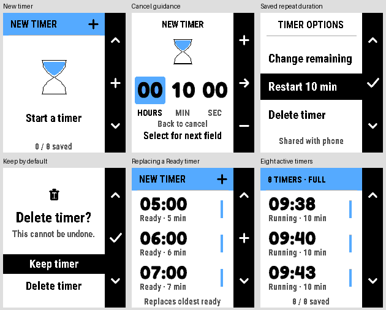

# Timer

A native timer for **stock PebbleOS**, with activity sharing for compatible
watchfaces such as [Dynamic](https://github.com/xefensor/dynamic-watchface).
The first target is Pebble Time 2 (`emery`, 200 × 228).

The local **0.8.0** implementation improves Timer's on-watch options and duration
editor: cancellation returns to its starting screen, Restart shows the saved
duration, and replacing an old Ready timer is explained before starting.
Activities, saved models, native alarms and the launcher countdown retain their
existing ownership. This version is validated locally; the published download
below remains 0.6.0.

Timer 0.6.0 is a [GitHub development prerelease](https://github.com/xefensor/pebble-app-timer/releases/tag/v0.6.0)
with a simple notification-style activity source, durable Done acknowledgement,
preserved repeat durations and a live countdown in the app list. Paused timers hide
from compatible watchfaces after five minutes and remain saved in Timer.
Download the [PBW](https://github.com/xefensor/pebble-app-timer/releases/download/v0.6.0/Timer-0.6.0.pbw),
[source archive](https://github.com/xefensor/pebble-app-timer/releases/download/v0.6.0/Timer-0.6.0-source.zip)
and [checksums](https://github.com/xefensor/pebble-app-timer/releases/download/v0.6.0/SHA256SUMS.txt).
See [validation](docs/VALIDATION.md) for the native emulator and packaged-runtime
checks; actual phone and physical-watch checks remain.
The [previous 0.5.0](https://github.com/xefensor/pebble-app-timer/releases/tag/v0.5.0)
and [0.4.0](https://github.com/xefensor/pebble-app-timer/releases/tag/v0.4.0)
and [earlier 0.2.0 release](https://github.com/xefensor/pebble-app-timer/releases/tag/v0.2.0)
and its historical validation remain unchanged.



These are actual 0.8.0 Emery captures with synthetic saved timers. The full
[0.5.0 native overview](docs/images/native-overview.png) retains its historical
alarm and launcher scope. The [approved browser concept](docs/design/Timer-UI-Preview.html)
remains design evidence, not a native or physical-watch capture.

## Version 0.8.0

- Name the list's add action New timer. At eight saved timers, explain when it
  will replace the oldest acknowledged Ready timer; retain the editor warning
  and block creation when all eight timers are active or otherwise ineligible.
- Cancel an Options edit back to Options, a direct detail edit back to detail,
  and a new timer back to the list. Keep the selected Options row when cancelling
  deletion with Keep or Back. Keep remains the initial confirmation choice.
- Show the saved repeat duration in Restart, including after a remaining-time
  edit or snooze. Add matching Back guidance for every duration field.
- Give both alarm hints eight pixels of bottom clearance without changing the
  hourglass, snooze, acknowledgement or alarm timing.
- Keep settings on the watch, where the timers are owned. No phone settings
  page, new storage format, activity-library update or alarm behavior is added.
- Preserve the existing button-hold guards, eight slots, paused visibility,
  native Wakeup ownership, sharing protocol and app-list countdown.

## Version 0.7.0

- Publish the new standard summary with a structured countdown and optional
  Timer app destination. Consumers choose layout and activity priority.
- Preserve owner revisions, original observations and leases through the
  snapshot-provider API. Acknowledged results disappear from the complete
  summary list, and an empty list still carries a newer response sequence.
- Keep the five-minute paused limit, the active deadline-plus-sixty-second
  bound, native alarm/storage ownership and eight independent slots.
- Retain live/session/card sources for older consumers. No native Timer command
  route is added: opening the app does not select or operate a particular timer.

## Version 0.6.0

- Publish `activity/live` schema 3 using Activities 0.3.0's simple API: Timer
  identity and one remaining countdown. The host chooses normal or compact
  presentation. Timer does not arrange labels, select watchface layouts or
  provide a meter.
- Retain `activity/session` and the compact `activity/card` source for compatible
  older hosts. All three projections preserve the original run, source revision,
  observation, expiry, paused visibility and acknowledged-result tombstones.
- Keep the native Timer UI, saved timer/bank formats, alarm scheduling and
  launcher countdown implementation. This release changes the publishing
  integration, without changing ownership of any timer or alarm.
- Preserve all earlier published artifacts and tags. Native screenshots below
  retain their original 0.5.0 validation scope.

## Version 0.5.0

- Show a compact Timer activity: remaining time and one identity caption.
  Keep elapsed in the Timer detail; generic activity supporting values remain
  available through the shared library's detailed projection.
- Done, Select and Back acknowledge an alarm durably. The completed run receives
  a newer source revision with its result hidden; reopening or reconnecting
  cannot renew a finished result's original visibility. Acknowledgement reaches
  a consumer through the existing phone sharing path when available.
- Preserve the saved repeat duration across one-minute snoozes and changes to
  remaining time. Remaining-time edits preserve elapsed progress; saving an
  unchanged editor leaves the existing deadline untouched. Editing a Ready
  timer changes its saved repeat duration without starting an alarm.
- Put running and paused timers before reusable Ready entries. List focus follows
  the same stable timer slot. When all eight slots are occupied, explicit Add
  can replace the oldest acknowledged Ready timer after an editor warning;
  running, paused and unacknowledged alarms are never reclaimed.
- Start common duration edits on Minutes. Select acknowledges the alarm; Up
  snoozes. The prior Down acknowledgement remains supported.
- Use native App Glance deadline templates for the app-list countdown after
  Timer closes, including the next running timer when an earlier deadline
  expires. Pause, acknowledgement and deletion clear or replace the glance.
  Launcher position remains controlled by PebbleOS.
- Coalesce same-second launcher changes and flush the latest state before a
  normal Back exit. This avoids the firmware rejecting a pause/clear update
  with the same creation timestamp as its preceding running countdown.
- Safely migrate the original single timer and pre-0.5.0 eight-slot storage
  banks. Preserve UUIDs, keys, saved timers, revision floors, native Wakeup
  ownership and five-minute paused visibility. Pin Activities 0.2.1.

## Version 0.4.0

- Bring the approved hourglass concept onto the native watch: rounded Fredoka
  countdowns, Roboto Condensed labels, a blue running hourglass, an amber paused
  state and a dark completion screen. The curved chambers transfer a fixed
  quantity of sand according to actual remaining time.
- Keep digits in fixed cells, with a separate size for long durations through
  24 hours. The three-row list shows progress and state; the duration editor
  highlights its current field. New timers default to ten minutes.
- Keep pause/resume one button away. More options contains Adjust, Restart
  and Delete; deleting requires confirmation, with Keep selected first.
  Restart preserves the slot and duration while creating a new run identity.
- Use short, bounded screen transitions and a one-second running stream.
  Paused content stays still, and covered screens stop decorative work.
  Deadlines and native Wakeup alarms remain authoritative.
- Put sharing status in More options. Storage and alarm scheduling failures
  remain visible on the relevant screen. Saved timers, eight slots, the
  five-minute paused visibility window and both source schemas are retained.
- Bundle the reviewed font sources and SIL notices. Native captures and
  release-specific checks are recorded in [validation](docs/VALIDATION.md).

## Version 0.3.1

- Hide a paused timer from activity consumers after five minutes. Reopening
  Timer, reconnecting, source polling and repeated sharing do not restart that
  window. Both session and card sources keep the same native expiry.
- Keep the paused timer saved and resumable in Timer after it disappears from
  the watchface. Resume makes it visible again with its new running deadline;
  explicitly editing its paused duration starts a new five-minute window.
- Cap older saved paused leases from their last native observation when
  upgrading. The stored timer format, eight slots and native alarms remain
  compatible.

## Version 0.3.0

- Keep the remaining countdown prominent and show a labelled elapsed time in
  Timer detail. The existing Edit, pause/resume, delete, snooze and Back controls
  remain available, with the same eight saved timer slots and native alarms.
- Publish the configured total duration alongside each immutable native snapshot.
  Compatible `activity/card` schema 2 consumers can show remaining and elapsed
  clocks from the same observation. Existing `activity/session` schema 1
  consumers remain supported.
- Elapsed means active time within the current duration setting. Pausing freezes
  it; editing the remaining duration establishes a new baseline. The persisted
  native timer model and upgrade migration remain unchanged.
- A native completed state can be shown as a bounded schema 2 result until its
  original terminal validity expires. Local countdown zero alone never completes
  a source record. Cancelling retracts the activity.
- Builds use pinned Pebble Activities 0.2.0. A saved older snapshot without total
  duration provides its remaining clock without inventing elapsed time.

## Version 0.2.0

- Testing prerelease: real-phone/plugin delivery, Bluetooth loss/reconnection
  and physical-watch alarm behavior remain to be verified on actual devices.
- Up to eight saved timers, a timer list and a hours/minutes/seconds editor.
- Large countdown, progress bubbles and a right-hand action bar for editing,
  pausing, resuming and deleting. Completed timers offer one-minute snooze.
- Native deadlines share one earliest-deadline Wakeup, avoiding conflicts when
  several timers end close together. Every due timer is checked on the watch.
- Migrate the previous saved timer without changing the app UUID. Versioned,
  checksummed storage banks preserve the prior committed state on a failed save.
- Share eight independent logical slots through pinned Pebble Activities 0.1.2.
  Reusing a slot while offline replaces its old phone snapshot on reconnection.
- The interface is independently implemented; no upstream Pebble Timer source,
  fonts or image assets are incorporated.
- A dedicated quick Extend action is deferred; use Edit to change the duration.

## Version 0.1.1

- Move the existing timer into its own repository, build and release pipeline.
- Rename the launcher entry to Timer while retaining its app UUID, saved timer
  format and provider storage identity for updates from Activity Timer 0.1.0.
- Pin Pebble Activities 0.1.0 as a local, checksummed dependency; no sibling
  checkout or separate library build is needed.
- Keep the existing one-timer controls and native alarm behaviour. The proposed
  Pebble-inspired interface and multiple-timer UI are not part of this release.

## What you install

Install **one Timer PBW**. It contains the native watchapp, its PKJS phone bridge
and a read-only provider plugin. Timer owns its saved timer and native Wakeup
alarm. The bridge saves the last reported state on the phone, and the plugin
exposes that state primarily as `activity/summary` v4. The summary contains one
structured countdown and a separate optional destination app. A host such as
Dynamic chooses its primary and one-row secondary presentation. Timer supplies
no coordinates, mandatory display labels, derived elapsed detail or layout
selection.

`activity/live` v3, `activity/session` v1 and compact `activity/card` v2 remain
available for older consumers. One activity category declares all four items and their
properties. Every view keeps the original native identity, revision and
timestamps. Polling cannot renew source observation or validity, and a
five-minute-old paused timer remains saved in Timer after its activity expires.

[Pebble Activities](https://github.com/xefensor/pebble-activities) supplies the
shared library and source convention. It is not another installed app or
background service. Timer's plugin may also appear in the phone app's Plugins
list because the same PBW provides both a watchapp and a data source.

Activity sharing requires a phone app with Pebble plugin support and the
relevant permissions or preview enabled. The native timer and an accepted
Wakeup alarm continue independently of sharing. The consumer receives a
phone-mediated snapshot, not direct access to another watchapp's memory.

## Controls

| Screen | Up | Select | Down | Back |
| --- | --- | --- | --- | --- |
| Timer list | Previous row | Open timer / New timer | Next row | Exit to watchface |
| Set timer | Increase selected field | Next field / start or save | Decrease selected field | Previous field / originating screen |
| Timer detail | Change remaining / saved duration | Pause / resume / repeat Ready | More options | Timer list |
| More options | Previous option | Choose option | Next option | Timer detail |
| Delete confirmation | Keep | Confirm selected choice | Delete | Cancel to Options |
| Time’s up | Snooze one minute | Done | Done (compatibility) | Done / timer list |

The editor sets hours, minutes and seconds, from five seconds to 24 hours.
The native app owns every deadline and alarm. Leaving the app or losing phone
connectivity does not cancel a successfully scheduled Wakeup.

The detail screen shows the remaining countdown, hourglass and Elapsed from one
native time read. Elapsed excludes paused time. Changing the remaining time keeps
the elapsed portion and adjusts the run's progress span; an unchanged save keeps
the deadline. The original saved repeat duration stays separate, including after
a one-minute snooze. Ready timers retain that saved duration for their next run.

Options and the duration editor are Timer's settings surface. The phone-side
code only shares native snapshots; there is no separate phone configuration
page. The [UX review](docs/UX-REVIEW.md) records the changes and retained behavior.

## Countdown in the app list

While a timer is running, its native deadline supplies an
[App Glance](https://developer.repebble.com/guides/user-interfaces/appglance-c/)
subtitle. PebbleOS updates the countdown while Timer is closed, without phone
JavaScript or a background worker. With several running timers, the earliest
deadline appears first and queued slices expire into the next running timer.
Paused or acknowledged saved timers do not leave a stale countdown behind.

The public SDK does not offer a temporary top-of-list position. The current
[launcher ordering implementation](https://github.com/coredevices/PebbleOS/blob/main/fw/process_management/app_menu_data_source.c)
reserves automatic promotion for specific system applications. This app updates
its subtitle and preserves the user's launcher order.
To keep Timer at the top manually, drag it upward in the phone app's
**My Apps** list, as described in
[Pebble's app organisation guide](https://help.repebble.com/en/articles/14166032-adding-watchfaces-apps).

The timer respects Quiet Time for vibration. PebbleOS controls missed-Wakeup
notifications. A scheduling failure displays “Alarm not set; keep open”
instead of claiming a background alarm was secured.

## Sharing and freshness

“Shared with phone” means that PKJS saved and read back the current revision and
returned a matching application receipt. It does not mean Dynamic has received
it. A native AppMessage transport ACK alone is insufficient.
Open More options to see this status; normal sharing messages do not cover the
countdown or hourglass. Storage and alarm failures stay visible while timing.

The provider marks its data as **last reported / unconfirmed**. Polling the
snapshot or reconnecting the phone cannot prove the watch timer has not changed
while disconnected. The original observation, deadline and validity are kept;
polling never makes an old snapshot fresh. A locally calculated zero does not
prove the native app completed or sounded its alarm.

State changes are persisted before publishing. Reopening Timer reconfirms the
native state. An unchanged paused timer keeps its original observation and
five-minute visibility deadline, including after that deadline has passed.
It remains available in Timer; Resume or an explicit duration edit publishes
a fresh visible state. Revisions and the PKJS handshake prevent queued old states
from replacing a newer run, including after native app data resets. Cancelled
and completed records are terminal state, not new consumer alerts. Schema 1
removes both terminal states. Schema 2 can display the native completed result
for its original, bounded validity while unacknowledged. Done publishes a newer,
hidden completed result; the saved timer remains reusable. Reconnection and
reopening never extend terminal validity. Cancellation still clears it. Native alarm
vibration remains owned by Timer, independently of either display source.

## Build and check

Use Node.js, Python 3, a C99 compiler, and a Pebble SDK with Emery support:

```sh
npm ci --ignore-scripts
npm test
npm run build
```

The dependency is installed from `vendor/pebble-activities-0.4.0.tgz`; its
provenance and SHA-256 are recorded in [vendor/README.md](vendor/README.md).

The distribution build clears the SDK cache so dependency updates cannot leave
stale phone JavaScript in the PBW. It writes `dist/Timer-0.8.0.pbw` and its checksum. It bundles the provider
JavaScript and sets `manifestVersion: 2`, including `plugin.js` alongside PKJS
and the watch binary. A plain `pebble build` creates a development PBW without
that extra provider bundle; use `npm run build` for an installable shared-activity
build. The packaged PBW includes the app and library licences and SDK notices.

Portable tests check the native timer model and isolated PKJS/storage/provider
handoff. Artifact checks exercise the packaged scripts. These do not substitute
for the actual phone or watch checks below.

Run the release-helper tests with
`python3 -m unittest discover -s tests -p 'test_*release.py'`. After building,
`python3 scripts/package-release.py` freezes the PBW, standalone source archive
and checksums. Committed artifacts are validated before GitHub publication.

See [validation](docs/VALIDATION.md) for the current release’s portable tests,
actual emulator captures and remaining physical-watch/real-phone checks.

## Actual phone and watch checks

These are a verification procedure, **not a claim that hardware testing has
been completed for this release**.

1. Enable plugin support and permission preview where required in the stock
   Pebble phone app. Install Timer and a compatible Dynamic PBW on the same
   Time 2. When upgrading Activity Timer, verify the existing saved timer is
   retained and only one launcher entry remains.
2. Add a timer from the + row, choose a duration and start it. Open More options
   and wait for “Shared with phone”, then return to Dynamic. Its countdown
   should use the same deadline.
3. Reopen Timer, pause, and return. Dynamic should show a fixed remaining time
   for five minutes, then hide it. Reopen Timer and return without editing;
   the paused timer must remain saved there and stay hidden on Dynamic. Resume
   it and verify it reappears. Pause and explicitly edit its duration to verify
   a fresh five-minute window, then delete it; each operation should update or
   clear the same run without replaying a completion.
4. Start another run and immediately exit before the application receipt. Timer
   must remain usable, and an old receipt must not acknowledge the new run.
5. Disconnect Bluetooth while starting or changing a timer. Back must remain
   usable. An accepted native Wakeup should still alert; Dynamic must not invent
   an unsent state or infer that the alarm rang.
6. Reconnect and reopen Timer. The current native state should replace the phone
   snapshot, including after restarting the phone app. Test multiple nearby deadlines and competing Wakeups
   and the five-second minimum on the actual firmware.

For local alarm diagnosis, run `ACTIVITY_TIMER_DIAGNOSTICS=1 pebble build`.
Opt-in logs contain only public timer state and cover scheduling, Wakeup lookup,
launch reason, callbacks and exit state. Normal release builds omit these logs.
A stored Wakeup or a completed timer shown after manual reopening does not prove
automatic launch.

## Design direction

The interface follows the familiar list, editor and button flow discussed with
[Pebble Timer](https://github.com/coredevices/pebble-timer) as a design reference.
It uses independently written rendering and the watch’s built-in fonts. Dynamic
owns its own grouped activity-clock presentation; Timer does not dictate a
watchface layout.

## Licence

[PolyForm Noncommercial License 1.0.0](LICENSE), with its required attribution.
See [third-party notices](THIRD-PARTY-NOTICES.md) for bundled Pebble Activities and
SDK components.
