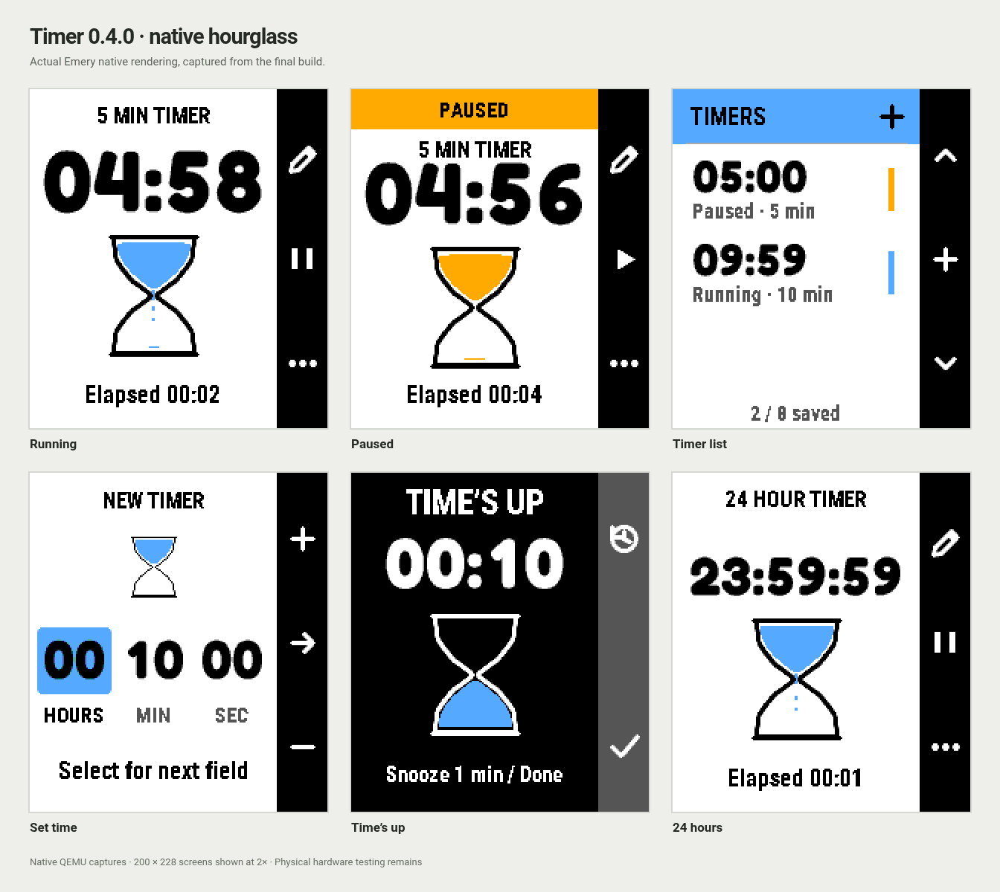

# Timer

A native timer for **stock PebbleOS**, with activity sharing for compatible
watchfaces such as [Dynamic](https://github.com/xefensor/dynamic-watchface).
The first target is Pebble Time 2 (`emery`, 200 × 228).

Timer 0.4.0 is a [GitHub development prerelease](https://github.com/xefensor/pebble-app-timer/releases/tag/v0.4.0)
with the approved hourglass design implemented natively. Paused timers hide
from compatible watchfaces after five minutes and remain saved in Timer.
Download the [PBW](https://github.com/xefensor/pebble-app-timer/releases/download/v0.4.0/Timer-0.4.0.pbw),
[source archive](https://github.com/xefensor/pebble-app-timer/releases/download/v0.4.0/Timer-0.4.0-source.zip)
and [checksums](https://github.com/xefensor/pebble-app-timer/releases/download/v0.4.0/SHA256SUMS.txt).
See [validation](docs/VALIDATION.md) for the native emulator and packaged-runtime
checks; actual phone and physical-watch checks remain.
The [earlier 0.2.0 release](https://github.com/xefensor/pebble-app-timer/releases/tag/v0.2.0)
and its historical validation remain unchanged.



These are actual native emulator captures from this release, displayed at
twice their 200 × 228 pixel size. The [approved browser concept](docs/design/Timer-UI-Preview.html)
is retained separately; it is not native or physical-watch verification.

## Version 0.4.0

- Bring the approved hourglass concept onto the native watch: rounded Fredoka
  countdowns, Roboto Condensed labels, a blue running hourglass, an amber paused
  state and a dark completion screen. The curved chambers transfer a fixed
  quantity of sand according to actual remaining time.
- Keep digits in fixed cells, with a separate size for long durations through
  24 hours. The three-row list shows progress and state; the duration editor
  highlights its current field. New timers default to ten minutes.
- Keep pause/resume one button away. More options contains Adjust, Restart
  and Delete; deleting requires confirmation, with Keep selected first.
  Restart preserves the slot and duration while creating a new run identity.
- Use short, bounded screen transitions and a one-second running stream.
  Paused content stays still, and covered screens stop decorative work.
  Deadlines and native Wakeup alarms remain authoritative.
- Put sharing status in More options. Storage and alarm scheduling failures
  remain visible on the relevant screen. Saved timers, eight slots, the
  five-minute paused visibility window and both source schemas are retained.
- Bundle the reviewed font sources and SIL notices. Native captures and
  release-specific checks are recorded in [validation](docs/VALIDATION.md).

## Version 0.3.1

- Hide a paused timer from activity consumers after five minutes. Reopening
  Timer, reconnecting, source polling and repeated sharing do not restart that
  window. Both session and card sources keep the same native expiry.
- Keep the paused timer saved and resumable in Timer after it disappears from
  the watchface. Resume makes it visible again with its new running deadline;
  explicitly editing its paused duration starts a new five-minute window.
- Cap older saved paused leases from their last native observation when
  upgrading. The stored timer format, eight slots and native alarms remain
  compatible.

## Version 0.3.0

- Keep the remaining countdown prominent and show a labelled elapsed time in
  Timer detail. The existing Edit, pause/resume, delete, snooze and Back controls
  remain available, with the same eight saved timer slots and native alarms.
- Publish the configured total duration alongside each immutable native snapshot.
  Compatible `activity/card` schema 2 consumers can show remaining and elapsed
  clocks from the same observation. Existing `activity/session` schema 1
  consumers remain supported.
- Elapsed means active time within the current duration setting. Pausing freezes
  it; editing the remaining duration establishes a new baseline. The persisted
  native timer model and upgrade migration remain unchanged.
- A native completed state can be shown as a bounded schema 2 result until its
  original terminal validity expires. Local countdown zero alone never completes
  a source record. Cancelling retracts the activity.
- Builds use pinned Pebble Activities 0.2.0. A saved older snapshot without total
  duration provides its remaining clock without inventing elapsed time.

## Version 0.2.0

- Testing prerelease: real-phone/plugin delivery, Bluetooth loss/reconnection
  and physical-watch alarm behavior remain to be verified on actual devices.
- Up to eight saved timers, a timer list and a hours/minutes/seconds editor.
- Large countdown, progress bubbles and a right-hand action bar for editing,
  pausing, resuming and deleting. Completed timers offer one-minute snooze.
- Native deadlines share one earliest-deadline Wakeup, avoiding conflicts when
  several timers end close together. Every due timer is checked on the watch.
- Migrate the previous saved timer without changing the app UUID. Versioned,
  checksummed storage banks preserve the prior committed state on a failed save.
- Share eight independent logical slots through pinned Pebble Activities 0.1.2.
  Reusing a slot while offline replaces its old phone snapshot on reconnection.
- The interface is independently implemented; no upstream Pebble Timer source,
  fonts or image assets are incorporated.
- A dedicated quick Extend action is deferred; use Edit to change the duration.

## Version 0.1.1

- Move the existing timer into its own repository, build and release pipeline.
- Rename the launcher entry to Timer while retaining its app UUID, saved timer
  format and provider storage identity for updates from Activity Timer 0.1.0.
- Pin Pebble Activities 0.1.0 as a local, checksummed dependency; no sibling
  checkout or separate library build is needed.
- Keep the existing one-timer controls and native alarm behaviour. The proposed
  Pebble-inspired interface and multiple-timer UI are not part of this release.

## What you install

Install **one Timer PBW**. It contains the native watchapp, its PKJS phone bridge
and a read-only provider plugin. Timer owns its saved timer and native Wakeup
alarm. The bridge saves the last reported state on the phone, and the plugin
exposes that state as `activity/session` v1 and `activity/card` v2 to compatible
consumers. One activity category declares both item names and their properties.
Both views keep the original native identity, revision and timestamps.

[Pebble Activities](https://github.com/xefensor/pebble-activities) supplies the
shared library and source convention. It is not another installed app or
background service. Timer's plugin may also appear in the phone app's Plugins
list because the same PBW provides both a watchapp and a data source.

Activity sharing requires a phone app with Pebble plugin support and the
relevant permissions or preview enabled. The native timer and an accepted
Wakeup alarm continue independently of sharing. The consumer receives a
phone-mediated snapshot, not direct access to another watchapp's memory.

## Controls

| Screen | Up | Select | Down | Back |
| --- | --- | --- | --- | --- |
| Timer list | Previous row | Open timer / add from + | Next row | Exit to watchface |
| Set timer | Increase selected field | Next field / start | Decrease selected field | Previous field / list |
| Timer detail | Adjust duration | Pause / resume / restart finished | More options | Timer list |
| More options | Previous option | Choose option | Next option | Timer detail |
| Delete confirmation | Keep | Confirm selected choice | Delete | Keep |
| Time’s up | Snooze one minute | — | Dismiss | Timer list |

The editor sets hours, minutes and seconds, from five seconds to 24 hours.
The native app owns every deadline and alarm. Leaving the app or losing phone
connectivity does not cancel a successfully scheduled Wakeup.

The detail screen shows the remaining countdown, hourglass and Elapsed from one native time read.
Elapsed excludes paused time within the current duration setting. Edit resets
that setting and its progress baseline; it is not a lifetime session counter.

The timer respects Quiet Time for vibration. PebbleOS controls missed-Wakeup
notifications. A scheduling failure displays “Alarm not set; keep open”
instead of claiming a background alarm was secured.

## Sharing and freshness

“Shared with phone” means that PKJS saved and read back the current revision and
returned a matching application receipt. It does not mean Dynamic has received
it. A native AppMessage transport ACK alone is insufficient.
Open More options to see this status; normal sharing messages do not cover the
countdown or hourglass. Storage and alarm failures stay visible while timing.

The provider marks its data as **last reported / unconfirmed**. Polling the
snapshot or reconnecting the phone cannot prove the watch timer has not changed
while disconnected. The original observation, deadline and validity are kept;
polling never makes an old snapshot fresh. A locally calculated zero does not
prove the native app completed or sounded its alarm.

State changes are persisted before publishing. Reopening Timer reconfirms the
native state. An unchanged paused timer keeps its original observation and
five-minute visibility deadline, including after that deadline has passed.
It remains available in Timer; Resume or an explicit duration edit publishes
a fresh visible state. Revisions and the PKJS handshake prevent queued old states
from replacing a newer run, including after native app data resets. Cancelled
and completed records are terminal state, not new consumer alerts. Schema 1
removes both terminal states. Schema 2 can display the native completed result
for its original, bounded validity; cancellation still clears it. Native alarm
vibration remains owned by Timer, independently of either display source.

## Build and check

Use Node.js, Python 3, a C99 compiler, and a Pebble SDK with Emery support:

```sh
npm ci --ignore-scripts
npm test
npm run build
```

The dependency is installed from `vendor/pebble-activities-0.2.0.tgz`; its
provenance and SHA-256 are recorded in [vendor/README.md](vendor/README.md).

The distribution build clears the SDK cache so dependency updates cannot leave
stale phone JavaScript in the PBW. It writes `dist/Timer-0.4.0.pbw` and its checksum. It bundles the provider
JavaScript and sets `manifestVersion: 2`, including `plugin.js` alongside PKJS
and the watch binary. A plain `pebble build` creates a development PBW without
that extra provider bundle; use `npm run build` for an installable shared-activity
build. The packaged PBW includes the app and library licences and SDK notices.

Portable tests check the native timer model and isolated PKJS/storage/provider
handoff. Artifact checks exercise the packaged scripts. These do not substitute
for the actual phone or watch checks below.

Run the release-helper tests with
`python3 -m unittest discover -s tests -p 'test_*release.py'`. After building,
`python3 scripts/package-release.py` freezes the PBW, standalone source archive
and checksums. Committed artifacts are validated before GitHub publication.

See [validation](docs/VALIDATION.md) for the current release’s portable tests,
actual emulator captures and remaining physical-watch/real-phone checks.

## Actual phone and watch checks

These are a verification procedure, **not a claim that hardware testing has
been completed for this release**.

1. Enable plugin support and permission preview where required in the stock
   Pebble phone app. Install Timer and a compatible Dynamic PBW on the same
   Time 2. When upgrading Activity Timer, verify the existing saved timer is
   retained and only one launcher entry remains.
2. Add a timer from the + row, choose a duration and start it. Open More options
   and wait for “Shared with phone”, then return to Dynamic. Its countdown
   should use the same deadline.
3. Reopen Timer, pause, and return. Dynamic should show a fixed remaining time
   for five minutes, then hide it. Reopen Timer and return without editing;
   the paused timer must remain saved there and stay hidden on Dynamic. Resume
   it and verify it reappears. Pause and explicitly edit its duration to verify
   a fresh five-minute window, then delete it; each operation should update or
   clear the same run without replaying a completion.
4. Start another run and immediately exit before the application receipt. Timer
   must remain usable, and an old receipt must not acknowledge the new run.
5. Disconnect Bluetooth while starting or changing a timer. Back must remain
   usable. An accepted native Wakeup should still alert; Dynamic must not invent
   an unsent state or infer that the alarm rang.
6. Reconnect and reopen Timer. The current native state should replace the phone
   snapshot, including after restarting the phone app. Test multiple nearby deadlines and competing Wakeups
   and the five-second minimum on the actual firmware.

For local alarm diagnosis, run `ACTIVITY_TIMER_DIAGNOSTICS=1 pebble build`.
Opt-in logs contain only public timer state and cover scheduling, Wakeup lookup,
launch reason, callbacks and exit state. Normal release builds omit these logs.
A stored Wakeup or a completed timer shown after manual reopening does not prove
automatic launch.

## Design direction

The interface follows the familiar list, editor and button flow discussed with
[Pebble Timer](https://github.com/coredevices/pebble-timer) as a design reference.
It uses independently written rendering and the watch’s built-in fonts. Dynamic
owns its own grouped activity-clock presentation; Timer does not dictate a
watchface layout.

## Licence

[PolyForm Noncommercial License 1.0.0](LICENSE), with its required attribution.
See [third-party notices](THIRD-PARTY-NOTICES.md) for bundled Pebble Activities and
SDK components.
